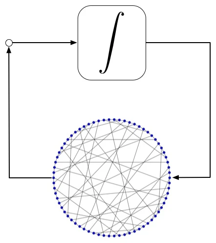
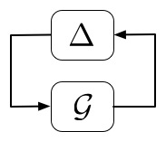
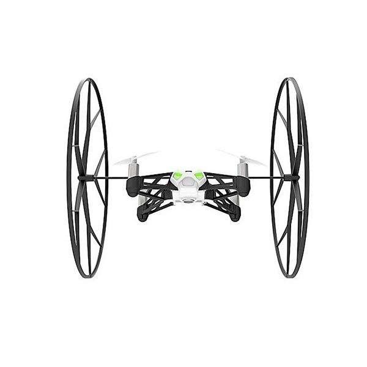

<nav class="editorial-jump-links" aria-label="Flagship courses">
  <a href="#NDS"><strong>0860730</strong> Multi-agent systems</a>
  <a href="#RoCon"><strong>0880792</strong> Robust control</a>
  <a href="#DroneLab"><strong>0850705</strong> Control laboratory</a>
</nav>

<section class="teaching-overview">
  
From abstraction to implementation

  <h2>Three views of a control problem.</h2>
  

    
<strong>Networks</strong>How local interactions create collective dynamics.

    
<strong>Uncertainty</strong>How guarantees survive imperfect models.

    
<strong>Experiments</strong>How estimation and feedback behave on real hardware.

  

</section>

<article class="course-feature" id="NDS" markdown="1">
<header>0860730
Graduate course
<h2>Coordination and Control of Multi-Agent Systems</h2></header>

Multi-agent systems are composed of dynamic units that interact through sensing, communication, or physical coupling. The course develops graph-theoretic and systems tools for understanding how those local connections determine stability, performance, and collective behavior.

### The arc of the course

- graph models for networked dynamical systems
- consensus, synchronization, and formation control
- stability and performance of distributed feedback
- network design and optimization methods
- examples from multi-robot coordination and distributed computation

Students from multiple Technion faculties are welcome. See the [official course listing](https://www.graduate.technion.ac.il/Subjects.Eng/?Sub=86730), or [contact Daniel](mailto:dzelazo@technion.ac.il) if you do not have a Technion email address.

<figure><figcaption>Graph structure and agent dynamics are studied as one interconnected system.</figcaption></figure>
</article>

<article class="course-feature course-feature--reverse" id="RoCon" markdown="1">
<header>0880792
Graduate course
<h2>Robust Control</h2></header>

Model-based design is useful only when we understand what happens as the model becomes wrong. Robust control provides a language for representing uncertainty and for certifying stability and performance across a family of possible systems.

### The arc of the course

- structured and unstructured uncertainty
- induced norms and input-output performance
- linear operator and small-gain viewpoints
- semidefinite programming for analysis and synthesis
- multivariable control design under model uncertainty

See the [official course listing](https://www.graduate.technion.ac.il/Subjects.Eng/?Sub=88792), or [contact Daniel](mailto:dzelazo@technion.ac.il) for access questions.

<figure><figcaption>Robust analysis asks which guarantees persist when dynamics and connections are uncertain.</figcaption></figure>
</article>

<article class="course-feature" id="DroneLab" markdown="1">
<header>0850705
Laboratory course
<h2>Control Laboratory</h2></header>

Students build a complete estimation and control system for autonomous quadcopter flight. The vehicle is modeled from first principles, sensors and actuators are characterized, and the full problem is divided into feedback loops that can be designed, simulated, and tested safely.

### The arc of the laboratory

- quadcopter modeling and actuator characterization
- sensor fusion and state estimation
- single-loop and multivariable controller design
- simulation, test-rig experiments, and free flight
- analysis of the gap between the model and the vehicle

<figure class="course-feature__media"><figcaption>The course progresses from modeling to autonomous free flight.</figcaption></figure>

  <iframe title="Control Lab quadcopter flight demonstration" src="https://www.facebook.com/plugins/video.php?href=https%3A%2F%2Fwww.facebook.com%2FTechnionAero%2Fvideos%2F351288040361759&show_text=0&width=560" loading="lazy" allowfullscreen="true" allow="autoplay; clipboard-write; encrypted-media; picture-in-picture; web-share"></iframe>

</article>

<aside class="teaching-more">
  
Additional teaching

  
Control Theory (0840738) · Dynamic Systems (0840737) · Undergraduate Seminar in Controls (0850802) · Control of Multi-Input Multi-Output Systems (0860289)

</aside>
