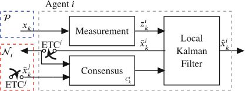
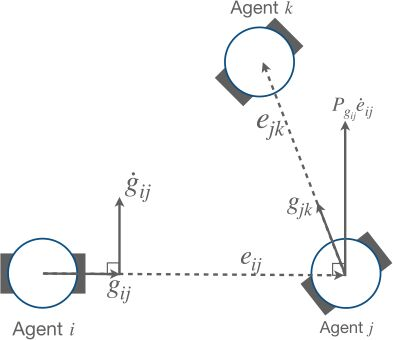
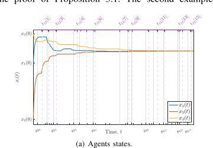

Continuous sensing and communication can be expensive for autonomous systems, especially when many agents must coordinate over shared or unreliable communication channels. Event-triggered and sampled-data strategies reduce this burden by updating only when new information is useful enough to justify communication or actuation.

This page focuses on event-triggered control, event-triggered estimation, and asynchronous sampled-data synchronization. Formation, filtering, and consensus results are included here when the triggering or sampling mechanism is the main contribution.

## Event-Triggered Estimation

  

    
Distributed estimation problems require agents to fuse intermittent observations and neighbor information while maintaining filter consistency. Event-triggered consensus Kalman filtering studies when communication can be skipped without compromising estimation quality.

    
Our work develops filter architectures for time-varying graphs, intermittent measurements, and event-based information exchange.

  

  

    <figure class="research-figure">
      
      <figcaption>The estimator architecture as presented in the consensus Kalman filtering paper.</figcaption>
    </figure>
  

Representative Publications:



## Event-Based Formation Control

  

    
In formation control, event-triggered mechanisms reduce communication while preserving the geometric constraints needed for convergence. The trigger must account for both the agent dynamics and the formation objective, since stale measurements can degrade stability or distort the desired formation.

    
This work connects event-triggered control with bearing-based formation stabilization and second-order multi-agent dynamics.

  

  

    <figure class="research-figure">
      
      <figcaption>A paper figure linking local bearing error, triggering, and formation geometry.</figcaption>
    </figure>
  

Representative Publications:



## Sampled-Data and Asynchronous Synchronization

  

    
Sampled-data synchronization studies how networked systems behave when agents communicate and update at discrete or asynchronous times. Rather than assuming continuous access to neighbor signals, the controller must tolerate sampling, delays, and irregular updates.

    
Our recent work develops emulation and asynchronous sampled-data approaches for output-feedback synchronization with small communication delays.

  

  

    <figure class="research-figure">
      
      <figcaption>Agent trajectories and asynchronous update times from the sampled-data synchronization study.</figcaption>
    </figure>
  

Representative Publications:



## Complete Related Publications

Related Publications:


