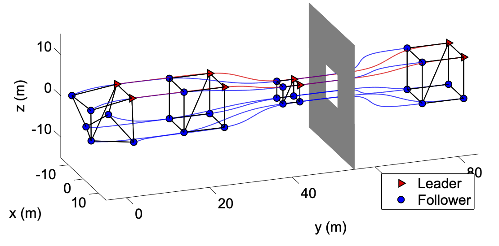

The group is primarily focused on the theoretical foundations of networked and multi-agent systems, but robotic validation is essential for testing which assumptions survive contact with real sensing, computation, communication, and actuation constraints.

Our robotic work provides experimental platforms for formation control, rigidity maintenance, aerial robotics, cooperative manipulation, and education-oriented control prototyping.

## Robot Platforms

We are developing ground and aerial robots for validating multi-agent control ideas and for involving students in hands-on systems research. The current platforms maintained by the group are listed below.

  
  
    <a class="research-platform-card" href="{{ product.url | prepend: site.baseurl }}">
      <figure></figure>
      

{{ product.title }}
{{ product.subtitle }}

    </a>
  

## Robotic Formation Validation

  

    
Formation-control theory becomes especially useful when it can be translated into controllers for ground robots, quadrotors, and heterogeneous teams. Robotic experiments expose practical issues such as range-only measurements, limited visual sensing, actuator saturation, and the need to preserve rigidity while moving through uncertain environments.

    
This work validates rigidity maintenance, bearing-based formation control, formation balancing, and multi-robot maneuvering on physical platforms.

  

  

    <figure class="research-figure">
      
      <figcaption>Formation maneuvering and validation on multi-robot platforms.</figcaption>
    </figure>
  

Representative Publications:



## Cooperative Manipulation and Open Platforms

  

    
Robotic validation also includes cooperative manipulation and open-source platforms for control education and rapid prototyping. These projects connect the group with experimental robotics collaborators and provide reusable infrastructure for future networked-control demonstrations.

    
Recent work includes rigidity-based cooperative manipulation and an open-source quadcopter platform for Simulink-based control design.

  

  

    <figure class="research-figure">
      
      <figcaption>Ground-robot testbed used for multi-agent control experiments.</figcaption>
    </figure>
  

Representative Publications:



## Complete Related Publications

Related Publications:


