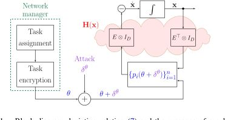
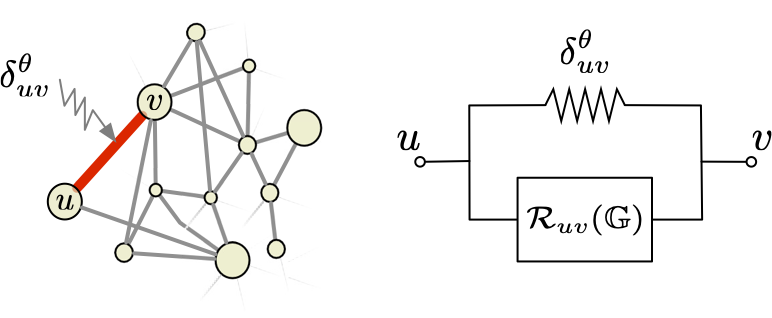
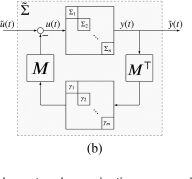

Large-scale networked systems must continue to operate despite uncertainty, faults, communication failures, and malicious interference. Security and resilience therefore need to be part of the control architecture, not only an after-the-fact detection layer.

Our work studies secure-by-design consensus, robustness of networked dynamics, structural resilience, and fault-tolerant graph properties. The emphasis on this page is the robustness and security layer; related consensus and network-identification methods are handled on their own pages when that is the primary contribution.

## Secure-by-Design Consensus

  

    
Secure-by-design consensus modifies the information exchanged over the network so that channel tampering can be detected or mitigated by the protocol structure itself. Instead of treating attacks as external disturbances, the controller architecture encodes redundancy and objective information directly into the consensus process.

    
Our work develops objective-coding methods and robustness analysis tools for structured channel tampering in consensus networks.

  

  

    <figure class="research-figure">
      
      <figcaption>The objective-coding architecture used to analyze structured channel tampering.</figcaption>
    </figure>
  

Representative Publications:



## Robust Consensus and Network Uncertainty

  

    
Robust consensus asks how graph weights, uncertainty, heterogeneity, and higher-order agent dynamics affect the ability of a network to reach agreement. These questions are especially important when the communication graph is weighted, directed, or only approximately known.

    
This work develops robustness measures, uncertainty analysis, and graph-dependent tools for consensus networks under model mismatch and heterogeneous dynamics.

  

  

    <figure class="research-figure">
      
      <figcaption>Graph-theoretic robustness measures for uncertain consensus networks.</figcaption>
    </figure>
  

Representative Publications:



## Structural Resilience and Fault Tolerance

  

    
Some resilience questions depend mainly on structure: which sparsity patterns preserve rank, how many faults can a cluster assignment tolerate, and where does the graph architecture create unavoidable vulnerability? These problems require tools from structural systems theory, graph theory, and combinatorics.

    
Our work studies structural rank, resilience of sparsity patterns, and fault-tolerant cluster assignment in multi-agent systems.

  

  

    <figure class="research-figure">
      
      <figcaption>A representative graph construction from the structural-rank and resilience study.</figcaption>
    </figure>
  

Representative Publications:



## Complete Related Publications

Related Publications:


